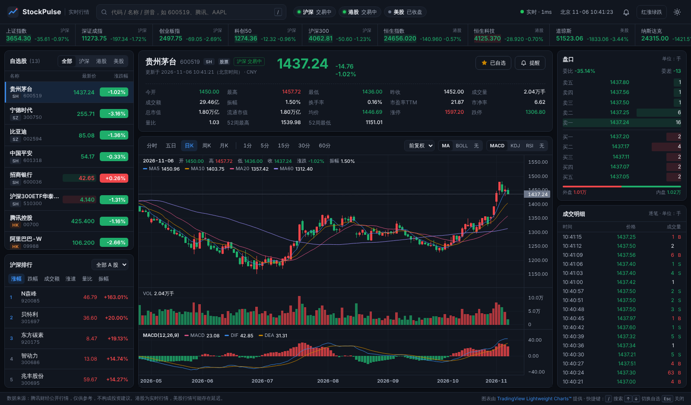
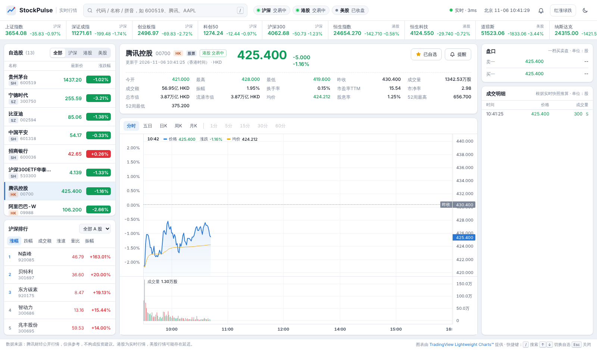

# StockPulse · 实时股票行情

一个开箱即用的实时行情看板，覆盖 **A 股（沪 / 深 / 北交所）、港股、美股**。服务端通过 WebSocket 推送实时报价，前端提供专业交易软件常见的分时图、K 线、技术指标、五档盘口、逐笔成交、市场排行、自选股与价格提醒。



<details>
<summary>浅色主题（港股分时）</summary>



</details>

## 功能

| 模块 | 说明 |
| --- | --- |
| 实时推送 | WebSocket 推送，交易时段默认 2 秒刷新，只推送有变化的代码；断线自动重连（指数退避），WebSocket 不可用时自动降级为 HTTP 轮询 |
| 指数行情条 | 上证、深成、创业板、科创 50、沪深 300、恒生、恒生科技、道琼斯、纳斯达克、标普 500 |
| 自选股 | 搜索添加 / 移除、按市场筛选、按列排序、拖拽排序、价格跳动闪烁，本地持久化 |
| 报价面板 | 最新价、涨跌、今开 / 最高 / 最低 / 昨收、成交量额、换手率、振幅、市盈率、市净率、市值、均价、涨跌停、量比、52 周高低等 |
| 分时图 | 当日与五日分时，价格线 + 均价线 + 成交量，左轴涨跌幅、右轴价格以昨收为中心对称对齐，时间轴补齐整个交易日 |
| K 线 | 日 / 周 / 月 K（前复权、不复权、后复权），A 股另有 1 / 5 / 15 / 30 / 60 分钟 K；主图 MA(5,10,20,60) / BOLL，副图 VOL + MACD / KDJ / RSI；十字光标图例；最后一根 K 线随推送实时更新 |
| 盘口 | A 股五档买卖盘（委比、委差、外盘 / 内盘），港美股一档 |
| 成交明细 | A 股逐笔成交（主动买卖方向、大单加粗）；港美股根据实时快照推算 |
| 市场排行 | 沪深京涨幅、跌幅、成交额、涨速、量比、振幅榜，可切换全部 A 股 / 创业板 / 科创板 |
| 价格提醒 | 价格 ≥ / ≤、涨幅 / 跌幅 ≥ N%，触发时页内提示 + 浏览器系统通知 + 提示音 |
| 搜索 | 代码 / 名称 / 拼音首字母；「键盘精灵」：在页面任意位置直接键入即可搜索 |
| 体验 | 深色 / 浅色主题、红涨绿跌 / 绿涨红跌切换、响应式布局（桌面三栏 / 平板两栏 / 手机单栏）、URL 分享（`/#/sh600519`）、快捷键 |

快捷键：`/` 聚焦搜索，直接输入字母或数字唤起搜索，`↑` / `↓` 切换自选股，`Esc` 关闭弹层。

## 快速开始

需要 Node.js 20 或更高版本。

```bash
npm install
npm start
# 打开 http://localhost:3000
```

其它命令：

```bash
npm run dev     # 修改服务端代码后自动重启
npm run demo    # 离线演示模式（模拟数据，无需外网）
npm test        # 运行测试（解析器、指标、REST 与 WebSocket 集成测试、静态构建检查）
npm run build:static  # 生成 GitHub Pages 静态站点到 dist/
```

使用 Docker：

```bash
docker build -t stockpulse .
docker run -p 3000:3000 stockpulse
```

## 部署到 GitHub Pages

仓库自带 GitHub Actions 工作流（`.github/workflows/pages.yml`），推送到 `main` 后会自动运行测试、构建静态站点并发布到 GitHub Pages。

首次使用需要在仓库里开启一次：

1. 打开仓库 **Settings → Pages**，在 **Build and deployment → Source** 中选择 **GitHub Actions**。
2. 合并到 `main`（或在 **Actions → Deploy to GitHub Pages → Run workflow** 手动运行）。
3. 部署完成后访问 `https://<用户名>.github.io/<仓库名>/`，例如 <https://clay-psy.github.io/Stock-market/>。

GitHub Pages 只能托管静态文件，无法运行 Node.js 服务，所以静态版本会自动切换为「浏览器直连」模式：

| | Node.js 服务端版 | GitHub Pages 静态版 |
| --- | --- | --- |
| 行情获取 | 服务端统一轮询，WebSocket 推送（约 2 秒） | 每个访问者的浏览器直接轮询腾讯接口（约 3 秒） |
| 排行榜 | 涨幅、跌幅、成交额、涨速、量比、振幅；全部 A 股 / 创业板 / 科创板 | 仅全部 A 股的涨幅、跌幅榜 |
| 其余功能 | 完整 | 与服务端版相同 |

搜索与逐笔成交接口不支持跨域请求，静态版通过 `<script>` 标签从 `smartbox.gtimg.cn`、`stock.gtimg.cn` 加载数据。本地预览静态产物：

```bash
npm run build:static         # 生成 dist/
npx serve dist               # 或任意静态文件服务器
```

页面根据 `<meta name="stockpulse-mode">` 选择模式（`auto` 自动探测 / `server` / `static`），也可以用 `?mode=static` 临时指定。

## 配置

通过环境变量或项目根目录的 `.env` 文件配置（参考 `.env.example`）：

| 变量 | 默认值 | 说明 |
| --- | --- | --- |
| `PORT` | `3000` | 监听端口 |
| `HOST` | `0.0.0.0` | 监听地址 |
| `DATA_PROVIDER` | `tencent` | `tencent`：腾讯财经公开行情；`mock`：离线模拟数据 |
| `QUOTE_INTERVAL_MS` | `2000` | 交易时段行情刷新间隔（最小 500） |
| `IDLE_QUOTE_INTERVAL_MS` | `30000` | 休市市场的刷新间隔 |
| `UPSTREAM_TIMEOUT_MS` | `8000` | 上游请求超时 |
| `MAX_SUBSCRIPTIONS` | `300` | 单个连接最多订阅的代码数 |
| `LOG_LEVEL` | `info` | `debug` / `info` / `warn` / `error` |

服务器需要通过 HTTP 代理访问外网时，可设置 `HTTPS_PROXY` 并以 `NODE_USE_ENV_PROXY=1 npm start` 启动（Node.js 22.21+ / 24+ 支持）。

## 架构

```
浏览器                                    Node.js 服务                          上游
┌──────────────────────┐   WebSocket   ┌─────────────────────────┐   HTTPS   ┌──────────────┐
│ RealtimeClient       │◀──── /ws ────▶│ QuoteHub                │──────────▶│ 腾讯财经行情  │
│  · 自动重连 / 心跳     │  订阅 / 推送   │  · 合并所有客户端订阅      │  批量轮询   │  qt.gtimg.cn │
│  · HTTP 轮询降级      │               │  · 只推送变化的报价         │           │  ifzq / rank │
│ Store（状态 + 本地存储）│   REST        │  · 休市降频、失败退避        │           └──────────────┘
│ 组件：自选/报价/图表/…  │◀── /api/* ───▶│ Express REST + TTL 缓存   │
└──────────────────────┘               │ Provider 适配层（可替换）   │
                                       └─────────────────────────┘
```

- **共用模块**（`shared/`）：服务端与浏览器都会加载。`tencent.js` 负责把腾讯接口的原始字段（GBK 编码、`~` 分隔）转换为统一的数据结构，网络访问通过注入的 `io` 完成；`symbols.js` 规范化代码；`cache.js` 提供 TTL 缓存与并发请求合并，多个用户同时查看同一只股票只会请求一次上游。
- **服务端**（`server/`）：Express 5 + `ws`。`providers/tencent.js` 用 Node.js 的 fetch 实现 `io`；`realtime.js` 是推送中心。
- **前端**（`public/`）：原生 ES Modules，无需构建。图表使用 [TradingView Lightweight Charts](https://www.tradingview.com/lightweight-charts/) v5，由服务端（或静态构建）从 `node_modules` 提供，不依赖外部 CDN。静态模式下 `js/data/direct-provider.js` 在浏览器里实现 `io`，`js/data/local-hub.js` 代替 WebSocket 在本地轮询。
- **扩展数据源**：实现与 `createTencentProvider` 返回值相同的接口（`getQuotes`、`getMinute`、`getKline`、`getTicks`、`getRank`、`search`、`getMarketStatus`）并在 `server/providers/index.js` 注册即可。

## 接口

### REST

| 方法 | 路径 | 说明 |
| --- | --- | --- |
| GET | `/api/health` | 服务状态、连接数、订阅数 |
| GET | `/api/market-status` | 沪深 / 港股 / 美股交易状态 |
| GET | `/api/quotes?symbols=600519,00700,AAPL` | 批量报价（代码自动识别市场） |
| GET | `/api/quote/:symbol` | 单只报价 |
| GET | `/api/search?q=茅台` | 搜索代码 / 名称 / 拼音 |
| GET | `/api/minute/:symbol?days=1\|5` | 分时数据 |
| GET | `/api/kline/:symbol?period=day&count=500&adjust=qfq` | K 线：`day` `week` `month` `m1` `m5` `m15` `m30` `m60`；复权 `qfq` `hfq` 或空 |
| GET | `/api/ticks/:symbol?limit=60` | 逐笔成交（A 股） |
| GET | `/api/rank?sort=changePct&order=desc&board=all&count=20` | 排行：`changePct` `amount` `volume` `speed` `volumeRatio` `amplitude`；板块 `all` `cyb` `kcb` |

代码格式：`sh600519`、`sz000001`、`bj920175`、`hk00700`、`hkHSI`、`usAAPL`、`usDJI`。接口也接受 `600519`、`700`、`AAPL` 这类简写。错误以 `{ "error": "..." }` 返回：400 参数错误、404 无数据、422 当前市场不支持、429 请求过于频繁、502 上游异常。

### WebSocket `/ws`

```jsonc
// 客户端 → 服务端
{ "type": "set", "symbols": ["sh600519", "hk00700"] }   // 覆盖式声明订阅集合
{ "type": "subscribe", "symbols": ["usAAPL"] }
{ "type": "unsubscribe", "symbols": ["usAAPL"] }
{ "type": "ping", "t": 1730000000000 }

// 服务端 → 客户端
{ "type": "hello", "provider": "tencent", "interval": 2000, "market": { ... } }
{ "type": "quotes", "data": [ { "symbol": "sh600519", "price": 1443.89, ... } ], "snapshot": true }
{ "type": "unknown", "symbols": ["sh999999"] }
{ "type": "market", "data": { "cn": { "open": true, "text": "交易中" }, ... } }
{ "type": "upstream", "ok": false, "message": "上游请求超时" }
{ "type": "pong", "t": 1730000000000, "serverTime": 1730000000005 }
```

## 数据说明与限制

- 行情来自腾讯财经的公开网页接口，并非官方开放 API，接口格式可能变化；字段解析集中在 `server/providers/tencent.js`，并有基于真实响应样本的测试（`test/fixtures`）。
- 港股使用实时行情；美股行情可能有延迟。
- 分钟 K 线与逐笔成交目前仅支持沪深京市场；港美股的成交明细由相邻两次快照的成交量差推算。
- 价格提醒在浏览器端计算，需要页面保持打开（可在后台标签页）。
- 本项目仅供学习与参考，不构成任何投资建议。

## 许可

MIT。图表库 Lightweight Charts™ 版权归 TradingView, Inc. 所有，按 Apache 2.0 许可使用，页面页脚保留了归属链接。
